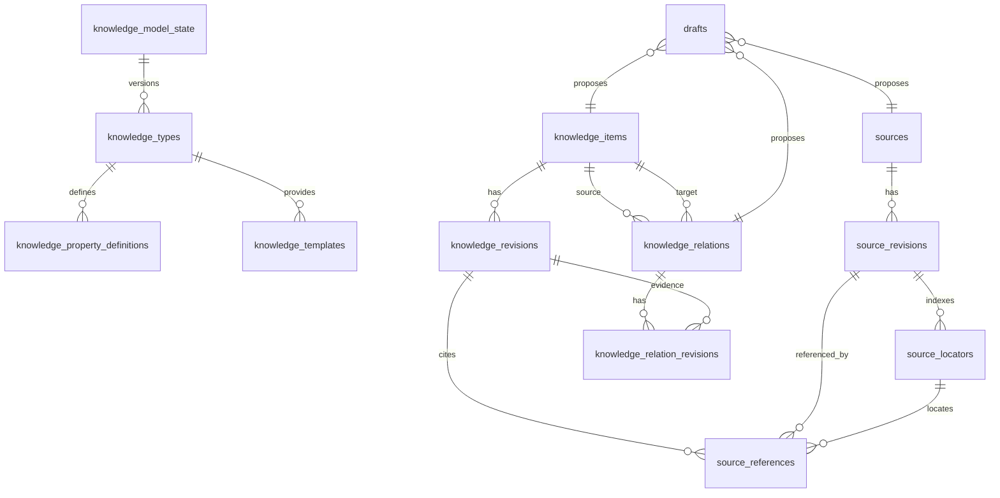

# 数据结构设计（G3 第一步）

> 需求名：mcp-first-v1.3-p0 ｜ 日期：2026-11-05 ｜ 状态：已实施
>
> 输入：`spec.md`、`audit.md`、当前 v2 数据库、Draft、FTS、审计与 Markdown 实现

## 1. 方案概述

选定方案：建立全新的 `Schema 1` 基线，用一个 Migration 创建 Knowledge Model、Source、SourceRevision、SourceLocator、Knowledge、KnowledgeRevision、SourceReference、KnowledgeRelation、统一 Draft、审计、幂等和全文索引结构。

备选方案“在 `documents` 上增加 recordType 后渐进拆分”被否决，因为项目未上线、旧数据无需迁移，而且混合表会长期保留 Source/Knowledge 两套语义冲突。

### 核心决定

1. 删除当前 `001` 至 `009` Migration 链，形成唯一 `001_mcp_first_baseline.sql`，`DatabaseMigrationCatalog.CurrentVersion = 1`。
2. 当前 Schema 9 数据库不作为可迁移来源；新应用发现更高的旧 Schema 时失败关闭，不自动改写或删除。
3. 不建立旧 Schema 兼容、双读双写、旧备份兼容或旧 Draft payload 兼容。
4. Source、Knowledge 使用独立主表和不可变 Revision；SourceReference 永远指向具体 SourceRevision。
5. Knowledge 的 Markdown 正文与结构化属性同时保存；结构化字段是权威数据，Frontmatter 只做导入、导出和展示映射。
6. 所有 AI 和 Web 正式变更进入统一 `drafts` 表，MCP 不拥有 apply/reject 能力。
7. 关系建议不再使用独立审核表，统一 Draft 的目标对象类型为 `relation`。
8. 搜索只保留 `keyword` 与 `fulltext`，全文索引基于 FTS5；新基线不创建任何 Semantic/Embedding 表。
9. SourceRule、WorkflowDefinition 与 Knowledge/关系定义同属可版本化 Knowledge Model。
10. 当前 Revision 使用延迟外键保证主对象和首版本可在同一事务中创建。

## 2. 复用清单

| 想要的能力 | 现有实现 | 复用方式 |
|---|---|---|
| 加密数据库、事务和 VaultSession | `SqliteMcDatabaseFactory`、`VaultDatabaseRuntime`、`VaultOperationContext` | 直接复用 |
| Migration 顺序、SHA256 和完整性校验 | `DatabaseInitializer`、`DatabaseMigrationCatalog` | 复用机制，替换 Migration 内容 |
| 稳定 Keyset Cursor | `CursorCodec`、`CursorPageRequest` | 直接复用 |
| 标签清洗与规范化 | `TagNormalizer` | 直接复用，错误文案由 Document 改为 Knowledge |
| Markdown Frontmatter 解析 | `FrontMatterDocument` | 复用 YAML 解析能力，新增模型映射校验 |
| Markdown 标题识别 | `MarkdownHeadings` | 扩展为带 offset 的 Source Section/Paragraph 索引 |
| FTS5 可用性检查 | `DatabaseInitializer.VerifyFts5Async` | 直接复用 |
| Draft revision、幂等和审计模式 | `DocumentDraftStore`、`IdempotencyStore`、`AuditStore` | 复用事务与冲突思路，重建为统一 Draft Store |
| MCP 鉴权、Session 与错误映射 | `McpBearerAuthentication*`、`McpToolInvoker`、`McpToolErrorMapper` | 保持协议层，改写业务 Tool |
| Web Cookie、CSRF、敏感状态清理 | 现有 Hosting、Antiforgery、Store 模式 | 直接复用 |

## 3. 领域模型与文件归属

### Core Contracts

- `v2/src/CipherVault.Core/KnowledgeModel/KnowledgeModelContracts.cs`
  - `KnowledgeModel`
  - `KnowledgeTypeDefinition`
  - `KnowledgePropertyDefinition`
  - `KnowledgeTemplate`
  - `RelationTypeDefinition`
  - `SourceRuleDefinition`
  - `WorkflowDefinition`
- `v2/src/CipherVault.Core/Sources/SourceContracts.cs`
  - `Source`
  - `SourceRevision`
  - `SourceLocator`
  - `SourceKind`
  - `SourceStatus`
  - `SourceContentFormat`
  - `SourceLocatorType`
- `v2/src/CipherVault.Core/Knowledge/KnowledgeContracts.cs`
  - `KnowledgeItem`
  - `KnowledgeRevision`
  - `SourceReference`
  - `KnowledgeStatus`
- `v2/src/CipherVault.Core/Relations/KnowledgeRelationContracts.cs`
  - `KnowledgeRelation`
  - `KnowledgeRelationRevision`
  - `KnowledgeRelationStatus`
- `v2/src/CipherVault.Core/Drafts/UnifiedDraftContracts.cs`
  - `DraftRecord`
  - `DraftTargetObjectType`
  - `DraftOperationType`
  - `DraftStatus`
- `v2/src/CipherVault.Core/Search/KnowledgeSearchContracts.cs`
  - `KnowledgeSearchMode` = `Keyword` / `Fulltext`
  - `KnowledgeSearchQuery`
  - `KnowledgeSearchHit`

### Core Stores

- `Storage/KnowledgeModel/KnowledgeModelStore.cs`
- `Storage/Sources/SourceStore.cs`
- `Storage/Knowledge/KnowledgeStore.cs`
- `Storage/Relations/KnowledgeRelationStore.cs`
- `Storage/Drafts/UnifiedDraftStore.cs`
- `Storage/Search/KnowledgeSearchStore.cs`
- `Storage/Audit/AuditStore.cs`，在现有类上改为通用 target。

### Application Services

- `KnowledgeModel/KnowledgeModelService.cs`
- `Sources/SourceService.cs`
- `Knowledge/KnowledgeService.cs`
- `Relations/KnowledgeRelationService.cs`
- `Drafts/UnifiedDraftService.cs`
- `Search/KnowledgeSearchService.cs`

具体方法签名在 G3 第二步接口清单中确定，此文件只定义数据结构与职责归属。

## 4. ER 关系



`drafts.target_id` 是多项式目标，不建立数据库外键；目标存在性和 revision 由 Application 在创建、送审和应用时校验。

## 5. DDL 草案

### 5.1 vault_meta 与 Schema 基线

```sql
CREATE TABLE vault_meta (
    key TEXT PRIMARY KEY,
    value TEXT NOT NULL
) STRICT;

INSERT INTO vault_meta(key, value)
VALUES
    ('vault_id', $vaultId),
    ('schema_version', '0'),
    ('created_at', $createdAtUtc);
```

Migration 文件名：

```text
v2/src/CipherVault.Core/Database/Migrations/001_mcp_first_baseline.sql
```

`DatabaseMigrationCatalog.CurrentVersion` 改为 `1`；删除旧 `001` 至 `009`。

### 5.2 Knowledge Model

```sql
CREATE TABLE knowledge_model_state (
    id INTEGER PRIMARY KEY CHECK (id = 1),
    version INTEGER NOT NULL CHECK (version >= 1),
    updated_at TEXT NOT NULL
) STRICT;

INSERT INTO knowledge_model_state(id, version, updated_at)
VALUES (1, 1, $createdAtUtc);

CREATE TABLE knowledge_types (
    type_id TEXT PRIMARY KEY
        CHECK (length(type_id) = 36),
    type_key TEXT NOT NULL UNIQUE
        CHECK (length(type_key) BETWEEN 1 AND 64),
    name TEXT NOT NULL
        CHECK (length(name) BETWEEN 1 AND 100),
    description TEXT
        CHECK (description IS NULL OR length(description) <= 500),
    is_enabled INTEGER NOT NULL DEFAULT 1
        CHECK (is_enabled IN (0, 1)),
    sort_order INTEGER NOT NULL DEFAULT 0,
    created_at TEXT NOT NULL,
    updated_at TEXT NOT NULL,
    CHECK (updated_at >= created_at)
) STRICT;

CREATE INDEX ix_knowledge_types_enabled_order
    ON knowledge_types(is_enabled, sort_order, type_id);

CREATE TABLE knowledge_property_definitions (
    property_id TEXT PRIMARY KEY
        CHECK (length(property_id) = 36),
    knowledge_type_id TEXT NOT NULL,
    property_key TEXT NOT NULL
        CHECK (length(property_key) BETWEEN 1 AND 64),
    name TEXT NOT NULL
        CHECK (length(name) BETWEEN 1 AND 100),
    value_type TEXT NOT NULL
        CHECK (value_type IN (
            'string', 'number', 'boolean', 'date', 'enum', 'array', 'object'
        )),
    is_required INTEGER NOT NULL DEFAULT 0
        CHECK (is_required IN (0, 1)),
    default_value_json TEXT
        CHECK (
            default_value_json IS NULL
            OR (
                json_valid(default_value_json)
                AND length(CAST(default_value_json AS BLOB)) <= 65536
            )
        ),
    constraints_json TEXT NOT NULL DEFAULT '{}'
        CHECK (
            json_valid(constraints_json)
            AND json_type(constraints_json) = 'object'
            AND length(CAST(constraints_json AS BLOB)) <= 65536
        ),
    is_enabled INTEGER NOT NULL DEFAULT 1
        CHECK (is_enabled IN (0, 1)),
    sort_order INTEGER NOT NULL DEFAULT 0,
    created_at TEXT NOT NULL,
    updated_at TEXT NOT NULL,
    UNIQUE (knowledge_type_id, property_key),
    CHECK (updated_at >= created_at),
    FOREIGN KEY (knowledge_type_id)
        REFERENCES knowledge_types(type_id)
        ON DELETE RESTRICT
) STRICT;

CREATE INDEX ix_property_type_order
    ON knowledge_property_definitions(
        knowledge_type_id, is_enabled, sort_order, property_id);

CREATE TABLE knowledge_templates (
    template_id TEXT PRIMARY KEY
        CHECK (length(template_id) = 36),
    knowledge_type_id TEXT NOT NULL,
    template_key TEXT NOT NULL
        CHECK (length(template_key) BETWEEN 1 AND 64),
    name TEXT NOT NULL
        CHECK (length(name) BETWEEN 1 AND 100),
    description TEXT
        CHECK (description IS NULL OR length(description) <= 500),
    body_template TEXT NOT NULL
        CHECK (length(CAST(body_template AS BLOB)) <= 1048576),
    fields_json TEXT NOT NULL DEFAULT '[]'
        CHECK (
            json_valid(fields_json)
            AND json_type(fields_json) = 'array'
            AND length(CAST(fields_json AS BLOB)) <= 65536
        ),
    is_enabled INTEGER NOT NULL DEFAULT 1
        CHECK (is_enabled IN (0, 1)),
    sort_order INTEGER NOT NULL DEFAULT 0,
    created_at TEXT NOT NULL,
    updated_at TEXT NOT NULL,
    UNIQUE (knowledge_type_id, template_key),
    CHECK (updated_at >= created_at),
    FOREIGN KEY (knowledge_type_id)
        REFERENCES knowledge_types(type_id)
        ON DELETE RESTRICT
) STRICT;

CREATE INDEX ix_templates_type_order
    ON knowledge_templates(
        knowledge_type_id, is_enabled, sort_order, template_id);

CREATE TABLE relation_types (
    relation_type_id TEXT PRIMARY KEY
        CHECK (length(relation_type_id) = 36),
    relation_key TEXT NOT NULL UNIQUE
        CHECK (length(relation_key) BETWEEN 1 AND 64),
    name TEXT NOT NULL
        CHECK (length(name) BETWEEN 1 AND 100),
    description TEXT
        CHECK (description IS NULL OR length(description) <= 500),
    is_directed INTEGER NOT NULL
        CHECK (is_directed IN (0, 1)),
    is_enabled INTEGER NOT NULL DEFAULT 1
        CHECK (is_enabled IN (0, 1)),
    sort_order INTEGER NOT NULL DEFAULT 0,
    created_at TEXT NOT NULL,
    updated_at TEXT NOT NULL,
    CHECK (updated_at >= created_at)
) STRICT;

CREATE INDEX ix_relation_types_enabled_order
    ON relation_types(is_enabled, sort_order, relation_type_id);

CREATE TABLE source_rules (
    source_rule_id TEXT PRIMARY KEY
        CHECK (length(source_rule_id) = 36),
    source_kind TEXT NOT NULL UNIQUE
        CHECK (source_kind IN (
            'web_page', 'local_file', 'book', 'podcast', 'other'
        )),
    metadata_schema_json TEXT NOT NULL DEFAULT '{}'
        CHECK (
            json_valid(metadata_schema_json)
            AND json_type(metadata_schema_json) = 'object'
            AND length(CAST(metadata_schema_json AS BLOB)) <= 65536
        ),
    supported_locator_types_json TEXT NOT NULL
        CHECK (
            json_valid(supported_locator_types_json)
            AND json_type(supported_locator_types_json) = 'array'
            AND length(CAST(supported_locator_types_json AS BLOB)) <= 4096
        ),
    is_enabled INTEGER NOT NULL DEFAULT 1
        CHECK (is_enabled IN (0, 1)),
    created_at TEXT NOT NULL,
    updated_at TEXT NOT NULL,
    CHECK (updated_at >= created_at)
) STRICT;

CREATE TABLE workflow_definitions (
    workflow_id TEXT PRIMARY KEY
        CHECK (length(workflow_id) = 36),
    workflow_key TEXT NOT NULL UNIQUE
        CHECK (length(workflow_key) BETWEEN 1 AND 64),
    name TEXT NOT NULL
        CHECK (length(name) BETWEEN 1 AND 100),
    description TEXT
        CHECK (description IS NULL OR length(description) <= 500),
    target_object_types_json TEXT NOT NULL
        CHECK (
            json_valid(target_object_types_json)
            AND json_type(target_object_types_json) = 'array'
            AND length(CAST(target_object_types_json AS BLOB)) <= 4096
        ),
    constraints_json TEXT NOT NULL DEFAULT '{}'
        CHECK (
            json_valid(constraints_json)
            AND json_type(constraints_json) = 'object'
            AND length(CAST(constraints_json AS BLOB)) <= 65536
        ),
    is_enabled INTEGER NOT NULL DEFAULT 1
        CHECK (is_enabled IN (0, 1)),
    sort_order INTEGER NOT NULL DEFAULT 0,
    created_at TEXT NOT NULL,
    updated_at TEXT NOT NULL,
    CHECK (updated_at >= created_at)
) STRICT;
```

### 5.3 Source 与 Source Locator

```sql
CREATE TABLE sources (
    source_id TEXT PRIMARY KEY
        CHECK (length(source_id) = 36),
    source_kind TEXT NOT NULL
        CHECK (source_kind IN (
            'web_page', 'local_file', 'book', 'podcast', 'other'
        )),
    title TEXT NOT NULL
        CHECK (length(title) BETWEEN 1 AND 200),
    title_key TEXT NOT NULL
        CHECK (length(title_key) BETWEEN 1 AND 200),
    metadata_json TEXT NOT NULL DEFAULT '{}'
        CHECK (
            json_valid(metadata_json)
            AND json_type(metadata_json) = 'object'
            AND length(CAST(metadata_json AS BLOB)) <= 65536
        ),
    status TEXT NOT NULL DEFAULT 'active'
        CHECK (status IN ('active', 'archived')),
    current_revision_id TEXT NOT NULL
        CHECK (length(current_revision_id) = 36),
    created_at TEXT NOT NULL,
    updated_at TEXT NOT NULL,
    archived_at TEXT,
    CHECK (updated_at >= created_at),
    CHECK (
        (
            status = 'active'
            AND archived_at IS NULL
        )
        OR
        (
            status = 'archived'
            AND archived_at IS NOT NULL
            AND archived_at >= created_at
            AND archived_at <= updated_at
        )
    ),
    FOREIGN KEY (source_id, current_revision_id)
        REFERENCES source_revisions(source_id, source_revision_id)
        ON DELETE RESTRICT
        DEFERRABLE INITIALLY DEFERRED
) STRICT;

CREATE INDEX ix_sources_status_updated
    ON sources(status, updated_at DESC, source_id);

CREATE INDEX ix_sources_kind_status
    ON sources(source_kind, status, source_id);

CREATE INDEX ix_sources_title_key
    ON sources(title_key, source_id);

CREATE TABLE source_revisions (
    source_revision_id TEXT PRIMARY KEY
        CHECK (length(source_revision_id) = 36),
    source_id TEXT NOT NULL,
    revision INTEGER NOT NULL
        CHECK (revision >= 1),
    source_kind TEXT NOT NULL
        CHECK (source_kind IN (
            'web_page', 'local_file', 'book', 'podcast', 'other'
        )),
    title TEXT NOT NULL
        CHECK (length(title) BETWEEN 1 AND 200),
    metadata_json TEXT NOT NULL DEFAULT '{}'
        CHECK (
            json_valid(metadata_json)
            AND json_type(metadata_json) = 'object'
            AND length(CAST(metadata_json AS BLOB)) <= 65536
        ),
    content_format TEXT NOT NULL
        CHECK (content_format IN ('markdown', 'text')),
    content_text TEXT NOT NULL
        CHECK (length(CAST(content_text AS BLOB)) <= 4194304),
    content_hash TEXT NOT NULL
        CHECK (
            length(content_hash) = 64
            AND content_hash NOT GLOB '*[^0-9a-f]*'
        ),
    knowledge_model_version INTEGER NOT NULL
        CHECK (knowledge_model_version >= 1),
    locator_index_version INTEGER NOT NULL DEFAULT 1
        CHECK (locator_index_version >= 1),
    created_at TEXT NOT NULL,
    UNIQUE (source_id, revision),
    UNIQUE (source_id, source_revision_id),
    UNIQUE (source_revision_id, source_id, revision),
    FOREIGN KEY (source_id)
        REFERENCES sources(source_id)
        ON DELETE RESTRICT,
    FOREIGN KEY (source_kind)
        REFERENCES source_rules(source_kind)
        ON DELETE RESTRICT
) STRICT;

CREATE INDEX ix_source_revisions_source
    ON source_revisions(source_id, revision DESC);

CREATE TABLE source_locators (
    source_locator_id TEXT PRIMARY KEY
        CHECK (length(source_locator_id) = 36),
    source_revision_id TEXT NOT NULL,
    locator_type TEXT NOT NULL
        CHECK (locator_type IN (
            'section', 'paragraph', 'page', 'timestamp'
        )),
    locator_key TEXT NOT NULL
        CHECK (length(locator_key) BETWEEN 1 AND 1024),
    locator_value_json TEXT NOT NULL
        CHECK (
            json_valid(locator_value_json)
            AND length(CAST(locator_value_json AS BLOB)) <= 8192
        ),
    label TEXT
        CHECK (label IS NULL OR length(label) <= 512),
    start_offset INTEGER
        CHECK (start_offset IS NULL OR start_offset >= 0),
    end_offset INTEGER
        CHECK (
            end_offset IS NULL
            OR (start_offset IS NOT NULL AND end_offset > start_offset)
        ),
    ordinal INTEGER NOT NULL
        CHECK (ordinal >= 0),
    parent_locator_id TEXT
        CHECK (parent_locator_id IS NULL OR length(parent_locator_id) = 36),
    UNIQUE (source_revision_id, locator_type, locator_key),
    UNIQUE (source_locator_id, source_revision_id),
    UNIQUE (
        source_locator_id,
        source_revision_id,
        locator_type,
        locator_key,
        locator_value_json
    ),
    CHECK (
        (
            locator_type IN ('section', 'paragraph')
            AND start_offset IS NOT NULL
            AND end_offset IS NOT NULL
        )
        OR
        locator_type IN ('page', 'timestamp')
    ),
    FOREIGN KEY (source_revision_id)
        REFERENCES source_revisions(source_revision_id)
        ON DELETE RESTRICT,
    FOREIGN KEY (parent_locator_id, source_revision_id)
        REFERENCES source_locators(source_locator_id, source_revision_id)
        ON DELETE RESTRICT
) STRICT;

CREATE INDEX ix_source_locators_revision
    ON source_locators(source_revision_id, locator_type, ordinal);
```

### 5.4 Knowledge、Tags 与 SourceReference

```sql
CREATE TABLE knowledge_items (
    knowledge_id TEXT PRIMARY KEY
        CHECK (length(knowledge_id) = 36),
    title TEXT NOT NULL
        CHECK (length(title) BETWEEN 1 AND 200),
    title_key TEXT NOT NULL
        CHECK (length(title_key) BETWEEN 1 AND 200),
    summary TEXT NOT NULL DEFAULT ''
        CHECK (length(summary) <= 4000),
    knowledge_type_id TEXT NOT NULL,
    status TEXT NOT NULL DEFAULT 'active'
        CHECK (status IN ('active', 'archived')),
    current_revision_id TEXT NOT NULL
        CHECK (length(current_revision_id) = 36),
    created_at TEXT NOT NULL,
    updated_at TEXT NOT NULL,
    archived_at TEXT,
    CHECK (updated_at >= created_at),
    CHECK (
        (
            status = 'active'
            AND archived_at IS NULL
        )
        OR
        (
            status = 'archived'
            AND archived_at IS NOT NULL
            AND archived_at >= created_at
            AND archived_at <= updated_at
        )
    ),
    FOREIGN KEY (knowledge_type_id)
        REFERENCES knowledge_types(type_id)
        ON DELETE RESTRICT,
    FOREIGN KEY (knowledge_id, current_revision_id)
        REFERENCES knowledge_revisions(knowledge_id, knowledge_revision_id)
        ON DELETE RESTRICT
        DEFERRABLE INITIALLY DEFERRED
) STRICT;

CREATE INDEX ix_knowledge_status_updated
    ON knowledge_items(status, updated_at DESC, knowledge_id);

CREATE INDEX ix_knowledge_type_status
    ON knowledge_items(knowledge_type_id, status, knowledge_id);

CREATE INDEX ix_knowledge_title_key
    ON knowledge_items(title_key, knowledge_id);

CREATE TABLE knowledge_revisions (
    knowledge_revision_id TEXT PRIMARY KEY
        CHECK (length(knowledge_revision_id) = 36),
    knowledge_id TEXT NOT NULL,
    revision INTEGER NOT NULL
        CHECK (revision >= 1),
    knowledge_type_id TEXT NOT NULL,
    template_id TEXT,
    knowledge_model_version INTEGER NOT NULL
        CHECK (knowledge_model_version >= 1),
    title TEXT NOT NULL
        CHECK (length(title) BETWEEN 1 AND 200),
    summary TEXT NOT NULL DEFAULT ''
        CHECK (length(summary) <= 4000),
    content_markdown TEXT NOT NULL
        CHECK (length(CAST(content_markdown AS BLOB)) <= 4194304),
    content_hash TEXT NOT NULL
        CHECK (
            length(content_hash) = 64
            AND content_hash NOT GLOB '*[^0-9a-f]*'
        ),
    properties_json TEXT NOT NULL DEFAULT '{}'
        CHECK (
            json_valid(properties_json)
            AND json_type(properties_json) = 'object'
            AND length(CAST(properties_json AS BLOB)) <= 262144
        ),
    tags_json TEXT NOT NULL DEFAULT '[]'
        CHECK (
            json_valid(tags_json)
            AND json_type(tags_json) = 'array'
            AND length(CAST(tags_json AS BLOB)) <= 32768
        ),
    created_at TEXT NOT NULL,
    UNIQUE (knowledge_id, revision),
    UNIQUE (knowledge_id, knowledge_revision_id),
    FOREIGN KEY (knowledge_id)
        REFERENCES knowledge_items(knowledge_id)
        ON DELETE RESTRICT,
    FOREIGN KEY (knowledge_type_id)
        REFERENCES knowledge_types(type_id)
        ON DELETE RESTRICT,
    FOREIGN KEY (template_id)
        REFERENCES knowledge_templates(template_id)
        ON DELETE RESTRICT
) STRICT;

CREATE INDEX ix_knowledge_revisions_item
    ON knowledge_revisions(knowledge_id, revision DESC);

CREATE TABLE knowledge_tags (
    knowledge_id TEXT NOT NULL,
    tag_key TEXT NOT NULL
        CHECK (length(tag_key) BETWEEN 1 AND 192),
    tag_label TEXT NOT NULL
        CHECK (length(tag_label) BETWEEN 1 AND 64),
    PRIMARY KEY (knowledge_id, tag_key),
    FOREIGN KEY (knowledge_id)
        REFERENCES knowledge_items(knowledge_id)
        ON DELETE RESTRICT
) STRICT;

CREATE INDEX ix_knowledge_tags_key
    ON knowledge_tags(tag_key, knowledge_id);

CREATE TABLE source_references (
    source_reference_id TEXT PRIMARY KEY
        CHECK (length(source_reference_id) = 36),
    knowledge_revision_id TEXT NOT NULL,
    source_id TEXT NOT NULL,
    source_revision_id TEXT NOT NULL,
    source_revision INTEGER NOT NULL
        CHECK (source_revision >= 1),
    source_locator_id TEXT NOT NULL,
    locator_type TEXT NOT NULL
        CHECK (locator_type IN (
            'section', 'paragraph', 'page', 'timestamp'
        )),
    locator_key TEXT NOT NULL
        CHECK (length(locator_key) BETWEEN 1 AND 1024),
    locator_value_json TEXT NOT NULL
        CHECK (
            json_valid(locator_value_json)
            AND length(CAST(locator_value_json AS BLOB)) <= 8192
        ),
    excerpt TEXT NOT NULL
        CHECK (length(excerpt) BETWEEN 1 AND 4000),
    extraction_metadata_json TEXT NOT NULL DEFAULT '{}'
        CHECK (
            json_valid(extraction_metadata_json)
            AND json_type(extraction_metadata_json) = 'object'
            AND length(CAST(extraction_metadata_json AS BLOB)) <= 16384
        ),
    created_at TEXT NOT NULL,
    FOREIGN KEY (knowledge_revision_id)
        REFERENCES knowledge_revisions(knowledge_revision_id)
        ON DELETE RESTRICT,
    FOREIGN KEY (source_revision_id, source_id, source_revision)
        REFERENCES source_revisions(source_revision_id, source_id, revision)
        ON DELETE RESTRICT,
    FOREIGN KEY (
        source_locator_id,
        source_revision_id,
        locator_type,
        locator_key,
        locator_value_json
    )
        REFERENCES source_locators(
            source_locator_id,
            source_revision_id,
            locator_type,
            locator_key,
            locator_value_json
        )
        ON DELETE RESTRICT
) STRICT;

CREATE INDEX ix_source_references_revision
    ON source_references(knowledge_revision_id, source_reference_id);

CREATE INDEX ix_source_references_source
    ON source_references(source_id, source_revision, knowledge_revision_id);
```

### 5.5 关系

```sql
CREATE TABLE knowledge_relations (
    relation_id TEXT PRIMARY KEY
        CHECK (length(relation_id) = 36),
    relation_type_id TEXT NOT NULL,
    source_knowledge_id TEXT NOT NULL,
    target_knowledge_id TEXT NOT NULL,
    status TEXT NOT NULL DEFAULT 'active'
        CHECK (status IN ('active', 'retracted')),
    current_revision_id TEXT NOT NULL
        CHECK (length(current_revision_id) = 36),
    created_at TEXT NOT NULL,
    updated_at TEXT NOT NULL,
    CHECK (source_knowledge_id <> target_knowledge_id),
    CHECK (updated_at >= created_at),
    FOREIGN KEY (relation_type_id)
        REFERENCES relation_types(relation_type_id)
        ON DELETE RESTRICT,
    FOREIGN KEY (source_knowledge_id)
        REFERENCES knowledge_items(knowledge_id)
        ON DELETE RESTRICT,
    FOREIGN KEY (target_knowledge_id)
        REFERENCES knowledge_items(knowledge_id)
        ON DELETE RESTRICT,
    FOREIGN KEY (relation_id, current_revision_id)
        REFERENCES knowledge_relation_revisions(relation_id, relation_revision_id)
        ON DELETE RESTRICT
        DEFERRABLE INITIALLY DEFERRED
) STRICT;

CREATE UNIQUE INDEX ux_knowledge_relations_active
    ON knowledge_relations(
        relation_type_id, source_knowledge_id, target_knowledge_id)
    WHERE status = 'active';

CREATE INDEX ix_knowledge_relations_source
    ON knowledge_relations(source_knowledge_id, status, target_knowledge_id);

CREATE INDEX ix_knowledge_relations_target
    ON knowledge_relations(target_knowledge_id, status, source_knowledge_id);

CREATE TABLE knowledge_relation_revisions (
    relation_revision_id TEXT PRIMARY KEY
        CHECK (length(relation_revision_id) = 36),
    relation_id TEXT NOT NULL,
    revision INTEGER NOT NULL
        CHECK (revision >= 1),
    relation_type_id TEXT NOT NULL,
    source_knowledge_id TEXT NOT NULL,
    target_knowledge_id TEXT NOT NULL,
    source_knowledge_revision_id TEXT NOT NULL,
    target_knowledge_revision_id TEXT NOT NULL,
    status TEXT NOT NULL
        CHECK (status IN ('active', 'retracted')),
    rationale TEXT NOT NULL
        CHECK (length(rationale) BETWEEN 1 AND 4000),
    evidence_json TEXT NOT NULL DEFAULT '[]'
        CHECK (
            json_valid(evidence_json)
            AND json_type(evidence_json) = 'array'
            AND length(CAST(evidence_json AS BLOB)) <= 65536
        ),
    knowledge_model_version INTEGER NOT NULL
        CHECK (knowledge_model_version >= 1),
    created_at TEXT NOT NULL,
    UNIQUE (relation_id, revision),
    UNIQUE (relation_id, relation_revision_id),
    UNIQUE (relation_revision_id, relation_id, revision),
    CHECK (source_knowledge_id <> target_knowledge_id),
    FOREIGN KEY (relation_id)
        REFERENCES knowledge_relations(relation_id)
        ON DELETE RESTRICT,
    FOREIGN KEY (relation_type_id)
        REFERENCES relation_types(relation_type_id)
        ON DELETE RESTRICT,
    FOREIGN KEY (source_knowledge_id, source_knowledge_revision_id)
        REFERENCES knowledge_revisions(knowledge_id, knowledge_revision_id)
        ON DELETE RESTRICT,
    FOREIGN KEY (target_knowledge_id, target_knowledge_revision_id)
        REFERENCES knowledge_revisions(knowledge_id, knowledge_revision_id)
        ON DELETE RESTRICT
) STRICT;

CREATE INDEX ix_relation_revisions_relation
    ON knowledge_relation_revisions(relation_id, revision DESC);
```

### 5.6 统一 Draft

```sql
CREATE TABLE drafts (
    draft_id TEXT PRIMARY KEY
        CHECK (length(draft_id) = 36),
    draft_revision INTEGER NOT NULL
        CHECK (draft_revision >= 1),
    target_object_type TEXT NOT NULL
        CHECK (target_object_type IN ('knowledge', 'source', 'relation')),
    operation_type TEXT NOT NULL
        CHECK (operation_type IN (
            'create', 'update', 'archive', 'restore', 'retract'
        )),
    target_id TEXT
        CHECK (target_id IS NULL OR length(target_id) = 36),
    base_revision INTEGER
        CHECK (base_revision IS NULL OR base_revision >= 1),
    base_model_version INTEGER NOT NULL
        CHECK (base_model_version >= 1),
    payload_version INTEGER NOT NULL
        CHECK (payload_version >= 1),
    payload_json TEXT NOT NULL
        CHECK (
            json_valid(payload_json)
            AND json_type(payload_json) = 'object'
            AND length(CAST(payload_json AS BLOB)) <= 4194304
        ),
    base_snapshot_json TEXT
        CHECK (
            base_snapshot_json IS NULL
            OR (
                json_valid(base_snapshot_json)
                AND json_type(base_snapshot_json) = 'object'
                AND length(CAST(base_snapshot_json AS BLOB)) <= 4194304
            )
        ),
    status TEXT NOT NULL DEFAULT 'draft'
        CHECK (status IN (
            'draft',
            'pending_review',
            'conflict',
            'applied',
            'rejected',
            'discarded',
            'expired'
        )),
    source_actor TEXT NOT NULL
        CHECK (source_actor IN ('user_ui', 'mcp')),
    created_at TEXT NOT NULL,
    updated_at TEXT NOT NULL,
    terminal_at TEXT,
    applied_object_type TEXT
        CHECK (
            applied_object_type IS NULL
            OR applied_object_type IN ('knowledge', 'source', 'relation')
        ),
    applied_object_id TEXT
        CHECK (
            applied_object_id IS NULL
            OR length(applied_object_id) = 36
        ),
    applied_object_revision INTEGER
        CHECK (
            applied_object_revision IS NULL
            OR applied_object_revision >= 1
        ),
    applied_at TEXT,
    CHECK (updated_at >= created_at),
    CHECK (
        (
            target_object_type = 'relation'
            AND operation_type IN ('create', 'update', 'restore', 'retract')
        )
        OR
        (
            target_object_type IN ('knowledge', 'source')
            AND operation_type IN ('create', 'update', 'archive', 'restore')
        )
    ),
    CHECK (
        (
            operation_type = 'create'
            AND target_id IS NULL
            AND base_revision IS NULL
            AND base_snapshot_json IS NULL
        )
        OR
        (
            operation_type <> 'create'
            AND target_id IS NOT NULL
            AND base_revision IS NOT NULL
            AND base_snapshot_json IS NOT NULL
        )
    ),
    CHECK (
        (
            status IN ('applied', 'rejected', 'discarded', 'expired')
            AND terminal_at IS NOT NULL
            AND terminal_at >= created_at
            AND terminal_at <= updated_at
        )
        OR
        (
            status IN ('draft', 'pending_review', 'conflict')
            AND terminal_at IS NULL
        )
    ),
    CHECK (
        (
            status = 'applied'
            AND applied_object_type = target_object_type
            AND applied_object_id IS NOT NULL
            AND applied_object_revision IS NOT NULL
            AND applied_at IS NOT NULL
            AND applied_at = terminal_at
        )
        OR
        (
            status <> 'applied'
            AND applied_object_type IS NULL
            AND applied_object_id IS NULL
            AND applied_object_revision IS NULL
            AND applied_at IS NULL
        )
    )
) STRICT;

CREATE INDEX ix_drafts_status_updated
    ON drafts(status, updated_at DESC, draft_id);

CREATE INDEX ix_drafts_target
    ON drafts(target_object_type, target_id, status, updated_at DESC)
    WHERE target_id IS NOT NULL;

CREATE INDEX ix_drafts_terminal
    ON drafts(terminal_at, draft_id)
    WHERE terminal_at IS NOT NULL;

CREATE TRIGGER trg_drafts_revision
BEFORE UPDATE ON drafts
WHEN NEW.draft_revision <> OLD.draft_revision + 1
BEGIN
    SELECT RAISE(ABORT, 'drafts.draft_revision must increment by one');
END;

CREATE TRIGGER trg_drafts_terminal_immutable
BEFORE UPDATE ON drafts
WHEN OLD.status IN ('applied', 'rejected', 'discarded', 'expired')
BEGIN
    SELECT RAISE(ABORT, 'terminal drafts are immutable');
END;

CREATE TRIGGER trg_drafts_identity_immutable
BEFORE UPDATE OF
    draft_id,
    target_object_type,
    operation_type,
    target_id,
    source_actor,
    created_at
ON drafts
WHEN
    NEW.draft_id <> OLD.draft_id
    OR NEW.target_object_type <> OLD.target_object_type
    OR NEW.operation_type <> OLD.operation_type
    OR NEW.target_id IS NOT OLD.target_id
    OR NEW.source_actor <> OLD.source_actor
    OR NEW.created_at <> OLD.created_at
BEGIN
    SELECT RAISE(ABORT, 'draft identity fields are immutable');
END;

CREATE TABLE idempotency_records (
    idempotency_key TEXT PRIMARY KEY
        CHECK (length(idempotency_key) = 36),
    actor_kind TEXT NOT NULL
        CHECK (actor_kind IN ('user_ui', 'mcp')),
    operation TEXT NOT NULL
        CHECK (operation IN (
            'knowledge_model.change',
            'draft.create',
            'draft.update',
            'draft.rebase',
            'draft.submit_review',
            'draft.apply',
            'draft.reject',
            'draft.discard'
        )),
    request_hash TEXT NOT NULL
        CHECK (
            length(request_hash) = 64
            AND request_hash NOT GLOB '*[^0-9a-f]*'
        ),
    result_json TEXT NOT NULL
        CHECK (
            json_valid(result_json)
            AND json_type(result_json) = 'object'
            AND length(CAST(result_json AS BLOB)) <= 2097152
        ),
    created_at TEXT NOT NULL,
    expires_at TEXT NOT NULL,
    CHECK (expires_at >= created_at)
) STRICT;

CREATE INDEX ix_idempotency_expiry
    ON idempotency_records(expires_at, idempotency_key);

CREATE TRIGGER trg_idempotency_no_update
BEFORE UPDATE ON idempotency_records
BEGIN
    SELECT RAISE(ABORT, 'idempotency_records is immutable');
END;
```

### 5.7 审计

```sql
CREATE TABLE audit_events (
    event_id TEXT PRIMARY KEY
        CHECK (length(event_id) = 36),
    occurred_at TEXT NOT NULL,
    actor_kind TEXT NOT NULL
        CHECK (actor_kind IN ('user_ui', 'mcp', 'system')),
    action TEXT NOT NULL
        CHECK (action IN (
            'vault.initialize',
            'knowledge_model.change',
            'source.create',
            'source.update',
            'source.archive',
            'source.restore',
            'source_revision.create',
            'knowledge.create',
            'knowledge.update',
            'knowledge.archive',
            'knowledge.restore',
            'source_reference.create',
            'relation.create',
            'relation.update',
            'relation.retract',
            'relation.restore',
            'draft.create',
            'draft.update',
            'draft.rebase',
            'draft.submit_review',
            'draft.apply',
            'draft.reject',
            'draft.discard',
            'draft.expire',
            'draft.cleanup',
            'backup.create',
            'backup.download',
            'backup.restore',
            'export.plaintext',
            'import.start',
            'import.complete',
            'import.failed',
            'mcp_token.rotate'
        )),
    target_object_type TEXT
        CHECK (
            target_object_type IS NULL
            OR target_object_type IN (
                'vault',
                'knowledge_model',
                'knowledge_type',
                'template',
                'relation_type',
                'source_rule',
                'workflow',
                'source',
                'source_revision',
                'knowledge',
                'source_reference',
                'relation',
                'draft',
                'backup',
                'export',
                'import',
                'mcp_token'
            )
        ),
    target_id TEXT
        CHECK (target_id IS NULL OR length(target_id) = 36),
    target_revision INTEGER
        CHECK (target_revision IS NULL OR target_revision >= 1),
    correlation_id TEXT
        CHECK (correlation_id IS NULL OR length(correlation_id) <= 128),
    result TEXT NOT NULL
        CHECK (result IN ('success', 'failed', 'cancelled', 'started')),
    details_json TEXT NOT NULL DEFAULT '{}'
        CHECK (
            json_valid(details_json)
            AND json_type(details_json) = 'object'
            AND length(CAST(details_json AS BLOB)) <= 4096
        )
) STRICT;

CREATE INDEX ix_audit_occurred
    ON audit_events(occurred_at DESC, event_id);

CREATE INDEX ix_audit_target
    ON audit_events(target_object_type, target_id, occurred_at DESC);

CREATE INDEX ix_audit_action
    ON audit_events(action, occurred_at DESC);

CREATE INDEX ix_audit_correlation
    ON audit_events(correlation_id, occurred_at DESC)
    WHERE correlation_id IS NOT NULL;

CREATE TRIGGER trg_audit_no_update
BEFORE UPDATE ON audit_events
BEGIN
    SELECT RAISE(ABORT, 'audit_events is append-only');
END;

CREATE TRIGGER trg_audit_no_delete
BEFORE DELETE ON audit_events
BEGIN
    SELECT RAISE(ABORT, 'audit_events is append-only');
END;
```

### 5.8 Knowledge FTS

```sql
CREATE VIRTUAL TABLE knowledge_fts USING fts5(
    knowledge_id UNINDEXED,
    title,
    summary,
    type_key,
    tags,
    content,
    tokenize = 'trigram'
);
```

FTS 不使用触发器双写；Draft 应用事务内显式删除并插入当前 Knowledge 的索引行。失败时随事务回滚。

### 5.9 不可变与生命周期触发器

```sql
CREATE TRIGGER trg_sources_no_delete
BEFORE DELETE ON sources
BEGIN
    SELECT RAISE(ABORT, 'sources must be archived, not deleted');
END;

CREATE TRIGGER trg_source_revisions_no_update
BEFORE UPDATE ON source_revisions
BEGIN
    SELECT RAISE(ABORT, 'source_revisions is append-only');
END;

CREATE TRIGGER trg_source_revisions_no_delete
BEFORE DELETE ON source_revisions
BEGIN
    SELECT RAISE(ABORT, 'source_revisions is append-only');
END;

CREATE TRIGGER trg_source_locators_no_update
BEFORE UPDATE ON source_locators
BEGIN
    SELECT RAISE(ABORT, 'source_locators is append-only');
END;

CREATE TRIGGER trg_source_locators_no_delete
BEFORE DELETE ON source_locators
BEGIN
    SELECT RAISE(ABORT, 'source_locators is append-only');
END;

CREATE TRIGGER trg_knowledge_items_no_delete
BEFORE DELETE ON knowledge_items
BEGIN
    SELECT RAISE(ABORT, 'knowledge_items must be archived, not deleted');
END;

CREATE TRIGGER trg_knowledge_revisions_no_update
BEFORE UPDATE ON knowledge_revisions
BEGIN
    SELECT RAISE(ABORT, 'knowledge_revisions is append-only');
END;

CREATE TRIGGER trg_knowledge_revisions_no_delete
BEFORE DELETE ON knowledge_revisions
BEGIN
    SELECT RAISE(ABORT, 'knowledge_revisions is append-only');
END;

CREATE TRIGGER trg_source_references_no_update
BEFORE UPDATE ON source_references
BEGIN
    SELECT RAISE(ABORT, 'source_references is append-only');
END;

CREATE TRIGGER trg_source_references_no_delete
BEFORE DELETE ON source_references
BEGIN
    SELECT RAISE(ABORT, 'source_references is append-only');
END;

CREATE TRIGGER trg_knowledge_relations_no_delete
BEFORE DELETE ON knowledge_relations
BEGIN
    SELECT RAISE(ABORT, 'knowledge_relations must be retracted, not deleted');
END;

CREATE TRIGGER trg_knowledge_relation_revisions_no_update
BEFORE UPDATE ON knowledge_relation_revisions
BEGIN
    SELECT RAISE(ABORT, 'knowledge_relation_revisions is append-only');
END;

CREATE TRIGGER trg_knowledge_relation_revisions_no_delete
BEFORE DELETE ON knowledge_relation_revisions
BEGIN
    SELECT RAISE(ABORT, 'knowledge_relation_revisions is append-only');
END;
```

## 6. 默认种子

### 6.1 知识类型

使用稳定 UUID 区间 `00000000-0000-4000-8000-0000000010xx`：

| key | name | typeId 后缀 |
|---|---|---|
| `note` | 笔记 | `01` |
| `article` | 文章 | `02` |
| `book` | 书籍 | `03` |
| `podcast` | 播客 | `04` |
| `plan` | 计划 | `05` |
| `reflection` | 反思 | `06` |

名称、描述、排序和启用状态可修改；`type_id` 与 `type_key` 稳定，不允许通过常规接口重命名，避免历史引用漂移。

### 6.2 关系类型

使用稳定 UUID 区间 `00000000-0000-4000-8000-0000000020xx`：

| key | name | directed |
|---|---|---|
| `supports` | 支持 | true |
| `refutes` | 反驳 | true |
| `complements` | 补充 | true |
| `exemplifies` | 举例 | true |
| `applies` | 应用 | true |
| `depends_on` | 依赖 | true |
| `belongs_to` | 属于 | true |
| `similar_to` | 相似 | false |
| `derived_from` | 来源于 | true |
| `validated_by_practice` | 实践验证 | true |

### 6.3 Source Rules

| sourceKind | metadataSchema 最小要求 | P0 定位 |
|---|---|---|
| `web_page` | `url` 必填字符串 | section、paragraph |
| `local_file` | `originalFileName` 必填字符串 | section、paragraph |
| `book` | 无额外必填 | section、paragraph |
| `podcast` | 无额外必填 | section、paragraph |
| `other` | 无额外必填 | section、paragraph |

`page`、`timestamp` 已进入数据字典，但默认 SourceRule 不启用；后续可按来源类型更新规则。

### 6.4 模板与工作流

- 首版不预置模板；用户可在模型维护页新增。
- 首版不预置工作流；`workflow_definitions` 先支持模型发现和约束存储，Prompt 执行留到后续切片。
- `knowledge_model_state.version` 初始为 `1`。同一模型维护事务内，所有定义变更完成后统一加一。

## 7. 不可变与生命周期规则

| 数据 | 不可变字段/规则 |
|---|---|
| `source_revisions` | 插入后不可更新或删除；内容变化只能新增 revision |
| `source_locators` | 随 SourceRevision 固定，不可更新或删除 |
| `knowledge_revisions` | 插入后不可更新或删除；内容、属性、标签变化只能新增 revision |
| `source_references` | 插入后不可更新或删除；依据变化进入新的 KnowledgeRevision |
| `knowledge_relation_revisions` | 插入后不可更新或删除；撤回应新增 revision |
| `audit_events` | append-only，不可更新或删除 |
| `idempotency_records` | 插入后不可更新 |
| `drafts` | revision 每次加一；终态不可再编辑；身份字段不可变 |
| `sources` / `knowledge_items` | 只允许更新当前 revision、显示元数据、archive 状态和更新时间；不物理删除 |
| `knowledge_relations` | 只允许更新当前 revision、status 和更新时间；不物理删除 |

- `knowledge_relation_revisions` 必须引用对应 relation 的两端 KnowledgeRevision。
- `source_references` 的 SourceRevision 与 SourceLocator 属于同一 revision。

## 8. 索引与查询决定

### Keyword

- 不使用正文全文匹配。
- `title_key` 承担标题关键字。
- `knowledge_tags.tag_key` 承担标签。
- `knowledge_items.knowledge_type_id` 通过 `knowledge_types.type_key` 过滤。
- `source_references.source_id` 支持来源过滤。
- 查询必须有固定 pageSize 上限和稳定排序 `updated_at DESC, knowledge_id`。

### Fulltext

- 使用 `knowledge_fts MATCH`，只检索当前 active Knowledge。
- 过滤条件与 Keyword 共用：type、tags、sourceIds、status、updatedAt。
- snippet 最多 2,000 字符，结果不返回完整正文。
- 短关键词不使用无界 LIKE；采用有界扫描或输入错误，具体在接口设计确认。

### Cursor

- 沿用 `CursorCodec.Fingerprint`，fingerprint 必须包含 mode、query、types、tags、sourceIds、status 和 pageSize。
- 不支持跨查询游标复用。

### Source Locator 规范

- Source 内容写入前统一换行为 `\n`；`start_offset`、`end_offset` 使用 UTF-16 code unit 半开区间 `[start, end)`，与现有文档读取合同一致。
- `locator_key` 必须是 `locator_value_json` 的 canonical JSON，不允许客户端自造另一套 key。
- `section.locator_value_json` 为标题路径数组，例如 `["第一章","背景"]`。
- `paragraph.locator_value_json` 为对象，例如 `{"sectionPath":["第一章","背景"],"ordinal":2}`，ordinal 从 0 开始。
- `page.locator_value_json` 预留给 `{"page":1}`。
- `timestamp.locator_value_json` 预留给 `{"startMs":0,"endMs":1000}`。
- `excerpt` 必须是对应 Locator 区间中规范化 Source 文本的精确子串；不允许 AI 生成无法在 SourceRevision 中定位的摘录。
- `source_references` 同时保存规范 locator 字段和复合外键，任何字段不一致都会在数据库层拒绝。

## 9. 旧表处置

新 Migration 不创建以下旧表：

- `documents`
- `document_revisions`
- `tags`
- `document_tags`
- `document_links`
- `document_fts`
- `document_drafts`
- `document_relations`
- `document_relation_suggestions`
- `semantic_profiles`
- `semantic_remote_consents`
- `semantic_index_jobs`
- `semantic_chunks`

旧 `audit_events`、`idempotency_records` 的列和操作白名单被新结构替换。

## 10. 迁移、备份和启动行为

- 新基线 Migration 数量为 1，版本为 1。
- 新 Vault 初始化后 `vault_meta.schema_version = 1`，`schema_migrations` 只有 `mcp_first_baseline`。
- `BackupCompatibilityPolicy` 改为只接受当前 Schema 1；删除 Schema 5/6/7/8 兼容测试和固定夹具。
- 备份 FormatVersion 可保持 `1`，因为包结构与加密 envelope 不变；Schema 字段变为 1。
- 遇到现有 Schema 9 数据库时，应用以 `UnsupportedVersion` 失败关闭，不自动迁移或删除。
- 用户如保留现有 `%LOCALAPPDATA%` 测试数据，需在应用外自行备份；本需求不触碰真实数据目录。
- Migration checksum 基线替换为单文件 SHA256。
- 测试保留：全新初始化、Schema 1 增量迁移、失败回滚、备份创建/恢复、Migration 校验和、Source/Knowledge/SourceReference 关联完整性。

## 11. AC 覆盖映射

| AC | 数据承接 |
|---|---|
| AC1-AC12 | Knowledge Model 七表、模型版本、稳定种子、审计 |
| AC13-AC24 | Source、SourceRevision、SourceRule、SourceLocator、归档和审计 |
| AC25-AC38 | Knowledge、KnowledgeRevision、KnowledgeTags、Frontmatter 映射、SourceReference、关系依据 |
| AC39-AC46 | `knowledge_fts`、keyword 索引、稳定分类过滤和事务内索引维护 |
| AC47-AC57 | MCP 层复用 Application；数据表支持模型、来源读取、Knowledge 搜索和统一 Draft |
| AC58-AC68 | `drafts`、`idempotency_records`、统一状态与正式对象写入 |
| AC69-AC80 | Web 读取上述表；无独立聊天或语义表 |
| AC81-AC95 | FK/CHECK/触发器、append-only、加密 DB、Schema 1、备份与关联完整性测试 |

具体接口任务映射在 G3 第二步补齐。

## 12. 风险与回滚

- 风险：新 Schema 1 会拒绝现有 Schema 9 数据库。缓解：启动失败关闭，不自动迁移；现有测试数据需用户人工备份。
- 风险：统一 `drafts.target_id` 无法使用单列外键。缓解：Application 和数据库测试共同覆盖目标存在性、revision 和状态。
- 风险：SourceLocator 与 SourceReference 多处冗余字段可能不一致。缓解：使用复合外键把 locator 规范值绑定到同一 SourceRevision。
- 风险：模型定义变化会让待审 Draft 失效。缓解：Draft 记录 `base_model_version`，应用时检测并转 conflict。
- 风险：FTS 手写同步遗漏。缓解：所有正式写入集中在统一 Draft Apply，事务内更新 FTS 并用索引完整性测试验证。
- 回滚：项目未上线，不提供向下 Migration。需要回退时恢复代码与整库备份；不执行真实用户数据自动转换。

## 13. G3 数据设计自检

- [x] 已先完成数据结构设计，未提前输出接口清单。
- [x] 所有 P0 对象均有表或明确复用承接。
- [x] Semantic、Direct Write Mode、旧 `documents` 和专用关系建议表不进入新基线。
- [x] Source 与 Knowledge 独立，SourceReference 固定 SourceRevision 和 Locator。
- [x] 统一 Draft 覆盖 Knowledge、Source、Relation。
- [x] 结构化 Knowledge 属性是权威数据，Frontmatter 仅做映射。
- [x] 新基线初始化、备份恢复、Migration checksum 和关联完整性均有测试承接。
- [x] 实现者冷读：子 agent 因 429 不可用，按 skill 降级由主会话完成冷读。
- [x] 冷读已修复：关系 Revision 复合外键、当前 Revision 同主对象约束、Draft targetId 不可变、SourceKind 绑定 SourceRule、不可变触发器 DDL、Locator canonical 规范。
- [x] DDL 以临时 SQLite3MC 内存库执行通过；21 张表、FK check、integrity check 和 FTS5 MATCH 通过。
